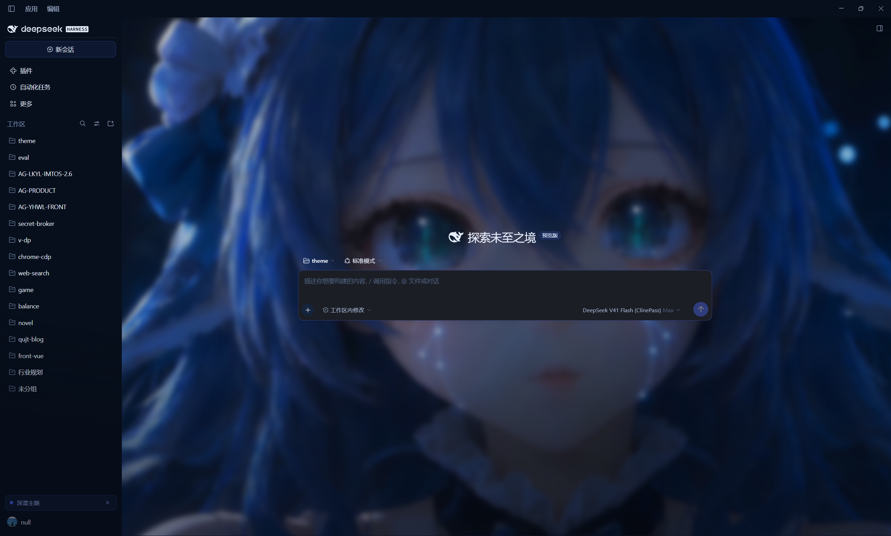
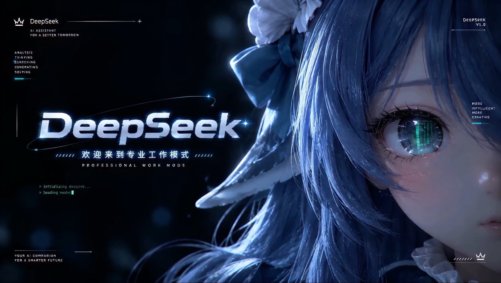

# dsh-theme-orbital · DeepSeek Blue

<a href="https://linux.do/"></a>

A **DeepSeek Blue theme plug-in for DSH** (DeepSeek Harness). It turns the Web GUI
into a single-hue, lightness-layered deep-sea interface — `BASE #050A14` /
`PANEL #070F1C` / `SURFACE #0B1626` / `GLASS #1B1E25`, brand `#4D6BFE`, beam
`#8AA2FF`, ink `#E6EDFB`, muted `#55688A`, every hairline at brand-14% — plays a
**4K intro film** on startup, and lays a **looping character wallpaper** behind
both the welcome screen and ongoing conversations.

**Single-scheme (locked dark):** the design does not follow DSH's appearance
preference — a light app setting still renders the abyss projection. Switch the
sidebar control back to the classic UI for the native light interface.

Nothing in the DSH installation is modified; uninstalling restores the stock UI.






## What it changes

| Layer | Mechanism | Result |
|---|---|---|
| Design tokens | Overrides every `--dsw-alias-*` token for both schemes, plus the `--dsw-specific-*` surfaces | Colours, borders, state colours, code blocks, menus and scrollbars all follow DeepSeek Blue |
| Geometry | Radius scale, transition durations, shadow levels | Soft glass surfaces, low elevation steps, cool-tinted borders |
| Ambience | Deep blue radial glow; the scan-line texture is off by default | A "diving" sense of depth without a field of horizontal lines over the conversation |
| Structure | Frame columns, composer, conversation area, boot screen, scrollbars | Dark-grey composer, brand-coloured sidebar selection bar, hairline dividers |
| Composer | A slow-drifting colour band around the card edge, whose light spills onto the wallpaper (`::before` draws the ring, `box-shadow` casts the wash; no box-size change, no extra DOM) | The "neon strip + light wash" look from the reference; intensity follows the `glow` preset, and `glow: off` fades band and spill out together. On focus the band and wash fade in over 380 ms (both shadow lists are layer-aligned so the pair is interpolable), and the placeholder/hint text is lifted inside the card |
| Motion | 4K intro film (falls back to the built-in HUD self-test animation), a 900 ms cross-fade started before the film's still tail, then the interface reveal | No more flash of an unthemed shell, no hard cut, and no "film ends, then nothing happens" |
| Window chrome | Drives the title-bar colours the DSH preload probes, while the veil plays (Windows desktop only) | The minimize / maximize / close plate no longer sits as a white block on the film; hidden by default |
| Wallpaper | Looping character film, blurred and sunk below the conversation content | **Shown on new sessions and on conversations with turns**, darker in dark mode, fainter in light mode |
| Controls | Sidebar-foot toggle (`≈ 深潜主题`) and replay (`▷`) | Switch between the theme and the native UI without reinstalling |

## Install

```bash
# 1) Fully quit the DSH desktop app (the desktop profile refuses package changes while it runs)
# 2) Install (link to this directory)
dsh plugin --profile desktop add "link:D:/project/qujinting/dsh-plugin/theme"
# 3) Start DSH again
```

Equivalently, add `dsh-theme-orbital` to `dependencies` (`link:` to this directory)
and to `dsh.profile.bundles` in `$DSH_HOME/profiles/desktop/package.json`, then run
`pnpm install` in that profile.

Remove it with `dsh plugin --profile desktop remove dsh-theme-orbital`.

The plug-in only contributes a Loader row plus index injections. It never writes
into the DSH installation, never touches the Electron shell, and never touches
session data.

## Configuration

Defaults from `cordis.patch.yml` (override by targeting `id: theme-orbital` in your
own profile patch):

```yaml
- id: theme-orbital
  name: 'dsh-theme-orbital'
  config:
    enabled: true          # master switch; false injects nothing
    animation: hud         # hud | fade | none
    introVideo: 'videos/进场60帧4K.mp4'       # 4K intro film; '' falls back to the CSS HUD veil
    backgroundVideo: 'videos/循环播放背景.mp4' # looping wallpaper; '' disables it
    backgroundScope: always # always: keep it behind ongoing conversations too; empty: only without turns
    backgroundOpacity: 0.85 # empty/welcome session: sharp
    backgroundBlur: 6       # px, 0–80
    backgroundOpacityConversation: 0.55   # ongoing conversations: background glow strength
    backgroundBlurConversation: 8
    playOn: cold           # always | cold (once per window session)
    durationMs: 1500       # minimum veil time, 800–4000
    holdMs: 350            # freeze before the fade when the film really ends, 0–3000
    introTailMs: 1500      # start the cross-fade this long before the film ends; 0 = wait for the end
    titleBar: hide         # Windows native title bar during the veil: hide | blend | off
    scanlines: false       # fine scan-line texture (off by default; it reads as a field of lines)
    grid: true             # centre-column deep glow
    glow: medium           # off | low | medium | high (also scales the composer band)
```

Film paths are relative to the package root; `videos/` ships two intro exports (120-frame and
60-frame 4K) and two looping backgrounds, and any mp4/webm of your own works too (only video
extensions are served, and only from inside the package).

`introTailMs` is what keeps the hand-off continuous: both shipped films end on ~1.5 s of
nearly still frames (measured: the picture stops moving around 5.5 s of a 7 s file), so
waiting for `ended` means freezing on the last frame before any fade. The controller now
starts the 900 ms cross-fade `introTailMs` before the film's end, so the film dissolves out
while the main UI fades in behind it. Set it lower (or `0`) for a film whose very last
frames matter — `0` restores "wait for the real end, then `holdMs`, then fade".

`titleBar` only applies to the **Windows desktop app**: `hide` (default) makes the caption plate
transparent and colours the glyphs with the film's own backdrop, so the controls read as absent;
`blend` keeps the plate transparent but recolours the glyphs for contrast (still visible and
clickable); `off` leaves the shell alone. The glyph colour is restored as the reveal starts and the
plate when the veil is removed, so no transparent title bar survives any exit path. Windows still
draws its hover tint, so the hidden buttons remain clickable during the intro.

The wallpaper renders in **both session states**: the conversation shell's opaque
`--dsw-alias-bg-base` is released, and the film is sunk to `z-index: -1` below the text and
cards instead of hazing over them. In a conversation it keeps 0.55 opacity, 8 px blur and
0.92 brightness — clear enough to read as a character, quiet enough not to fight the copy.
Set `backgroundScope: empty` to drop it from conversations entirely.

4K decoding is not free: the intro only plays once per window session under `playOn: cold`. The
wallpaper stays visible inside conversations by default, but on a much cheaper setting; use
`backgroundScope: empty` to stop it there entirely.

## How it works

The DSH web client has no first-class "theme plug-in" concept, but it exposes four
useful seams:

1. **Index injection** — a host plug-in may push `style` / `html` / `script` rows into
   every index response through `webserver/index-inject`. The desktop app collects the
   same table with `webServer.collectIndexInjections()` and applies it before the app
   mounts, so the theme and the veil are in place before the first paint.
2. **Token layer** — ui-layout writes `--dsw-alias-*` values as **inline styles** on
   `<body>`; a stylesheet can outrank them with `!important` without knowing which
   scheme the user picked. Tokens alone are not enough, though: some components (the
   changed-files card, diff fills, menus) pick a **static neutral scale** from
   `body[data-ds-dark-theme]`. The theme therefore sets that attribute on `<body>` before
   the app mounts and re-asserts it if the shell clears it, so those branches go dark too.
3. **Boot hand-off** — the shell renders a framework-free `[data-dsh-boot]` screen
   ("HARNESS / Loading plugins…") and then hydrates the React app over it. The veil
   covers the whole transition and reveals once `[data-dsh-boot]` is gone and
   `[data-shell-overlay]` exists. For the film path the controller does not wait for
   `ended`: it starts the 900 ms cross-fade at `duration − introTailMs`, so the film's
   still tail dissolves into an already-entering interface instead of freezing first.
4. **Windows title bar** — the desktop preload measures `--dsw-specific-sidebar-fill`
   (overlay plate) and `--dsw-alias-label-primary` (glyph colour) on a hidden probe and
   pushes them over the `windowsAppearance` IPC to `mainWindow.setTitleBarOverlay`.
   Writing both onto `<body>` inline (`!important`, so they beat the token layer) while
   the veil plays makes the plate see-through; the glyph colour is released when the
   reveal starts and the plate when the veil is removed. The probe only re-measures on
   body-attribute and head mutations, which is why the override must live on `<body>`.
   Windows desktop only; a no-op in browsers and on macOS.

The browser half (`lib/client.js`) does three things: it **refreshes the stylesheet**
by revision (the desktop app only collects injections once per launch, so a refresh
would otherwise keep stale CSS), owns the switch, and mounts the sidebar control.

### Layout

```
theme/
  palette.json   single source of truth: alias / specific / metrics
  theme.css      structure, materials, boot screen, veil animation
  boot.html      veil markup
  boot.js        reveal controller (inline; exposes __dshThemePlayVeil)
lib/
  index.js       host half: injection rows, /api/dsh-theme/* routes, diagnostics
  client.js      browser half: stylesheet freshness, switch, sidebar control, window.__dshTheme
test/            offline deterministic tests (no browser, no DSH)
```

## Development

```bash
npm test     # eight suites: manifest / palette / css / inject / routes / client / titlebar / reveal
npm run check
```

| Change | Takes effect |
|---|---|
| `lib/index.js`, `cordis.patch.yml` | **Restart DSH** (Node module cache) |
| `theme/*.css`, `*.html`, `*.js`, `palette.json` | **Refresh the page** (the client fetches by revision) |
| `videos/*` | Refresh the page (routes read from disk per request) |
| `lib/client.js` | Refresh the page (bundle revision follows mtime/size) |

Veil markup and config changes need a desktop restart, because the desktop app
collects the injection table once per launch.

### Debugging

In the page console:

```js
__dshTheme.status()    // { enabled, revision, hasInjectedStylesheet, playVeil, lastError }
__dshTheme.replay()    // replay the entrance animation
__dshTheme.disable()   // switch back to the native UI (persisted)
__dshTheme.enable()
```

Loopback-only host routes:

| Path | Purpose |
|---|---|
| `GET /api/dsh-theme/status` | Config, revision, film paths, per-file revisions |
| `GET /api/dsh-theme/injected.css` | The exact injected stylesheet (`?rev=` / ETag → 304) |
| `GET /api/dsh-theme/theme.css` | Authored stylesheet only |
| `GET /api/dsh-theme/palette.json` | Palette |
| `GET /api/dsh-theme/boot.html`, `boot.js` | Veil markup and controller (used by replay) |
| `GET /api/dsh-theme/video/intro`, `video/bg` | Intro film and wallpaper (byte ranges supported — required by the browser media stack) |

Failures cannot white-screen the app: both halves wrap their work in `try/catch`,
record the error in `localStorage['dsh-theme-orbital.last-error']`, and the veil has a
CSS-only 4-second fail-safe plus `pointer-events: none` for its whole lifetime.

## Design language (DeepSeek Blue)

One hue, layered by lightness; every hairline is the brand colour at 14%.

| Token | Value | Role |
|---|---|---|
| BASE | `#050A14` | application ground |
| PANEL | `#070F1C` | sidebar / native title bar |
| SURFACE | `#0B1626` | primary panels, cards |
| GLASS | `#1B1E25` | composer, control surfaces (dark grey) |
| BRAND | `#4D6BFE` | selection bar, focus, buttons |
| BEAM | `#8AA2FF` | secondary highlight, links, glyphs |
| INK | `#E6EDFB` | body text |
| MUTED | `#55688A` | captions, metadata |

Type: body copy 13 / line-height 22; statistics and status rows stay monospace. The
palette keeps a light projection (`#F4F7FE` ground, `#3D5AF1` brand) for the palette
contract, but this release only renders the dark projection. Switching back to the
classic UI restores the native light interface.

## Known limits

- **Layout is re-skinned, not replaced.** DSH's `root` slot is single-occupant and owned
  by ui-layout, so a plug-in cannot replace the React tree. The three-column frame,
  drag handles and collapse logic stay authoritative; the theme changes surfaces,
  spacing, separators and decoration. `grid-template-columns` is deliberately untouched
  because the handles position themselves from absolute column widths.
- **The wallpaper needs the conversation shell to open up.** The shell's
  `.an3WzG_root` paints its own opaque `--dsw-alias-bg-base`, so the theme turns
  `div:has([data-conversation-region])` transparent and sinks the film to `z-index: -1`;
  that is what makes the wallpaper show below ongoing conversations. Class names are
  build hashes, so the rules only rely on `data-conversation-*` attributes and structure.
- **A few selectors track the DSH build.** Components are targeted through stable
  `data-composer-*` / `data-conversation-*` / `data-chat-*` hooks where they exist, but
  the AppFrame columns expose no attribute, so they are located structurally
  (`#root div:has(> [data-shell-overlay]) > div:nth-of-type(n)`). That block lives in
  `theme.css` §2. Currently matched to **0.2.1-rc.5**.
- **One theme plug-in per composition.** Token overrides use `!important`; two themes
  would fight over the same names.
- **Single-scheme dark.** The design only has a dark projection: the host token layer
  emits `pair.dark` under both `html body` and `html body[data-ds-dark-theme]`, the
  browser half repeats `pair.dark` as body-inline `!important`, and it sets
  `data-ds-dark-theme` on the body (locking `color-scheme` too), so DSH's light
  preference cannot lighten the UI. Use the sidebar switch to go back to the classic UI.
- **The Electron welcome window** (`renderer/welcome.html`) and the main window's size
  belong to the shell and are out of reach; the animation starts once the app index loads.
- **The Windows title bar can be recoloured, not removed.** Chromium/Windows draws those
  three buttons above the page, so a plug-in can only drive the plate colour and the glyph
  colour (through the preload probe plus the `windowsAppearance` IPC). `hide` colours the
  glyphs with the film backdrop, which reads as absent; Windows still draws its hover tint,
  so the buttons stay clickable. The option does nothing outside the Windows desktop app.
- `playOn: cold` uses `sessionStorage`, i.e. "once per window session"; a reload inside
  the same desktop window does not replay.
- With `backgroundScope: always` the 4K wallpaper keeps decoding behind conversations
  (cheaper settings, same decode). Use `empty` if power draw matters more.

## License

MIT for the plug-in code (see [LICENSE](LICENSE)). No third-party fonts, images or
models are bundled; the veil artwork is inline SVG coloured from the brand / beam accents.

## Community

This open-source project is linked to and recognises the [LINUX DO community](https://linux.do/) — 新的理想型社区, "where possible begins".
