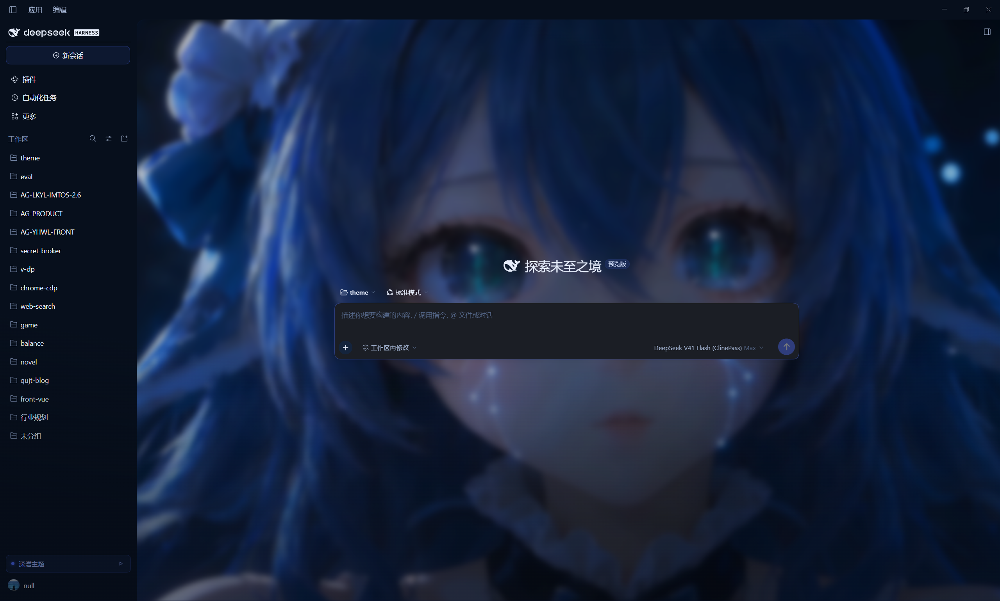
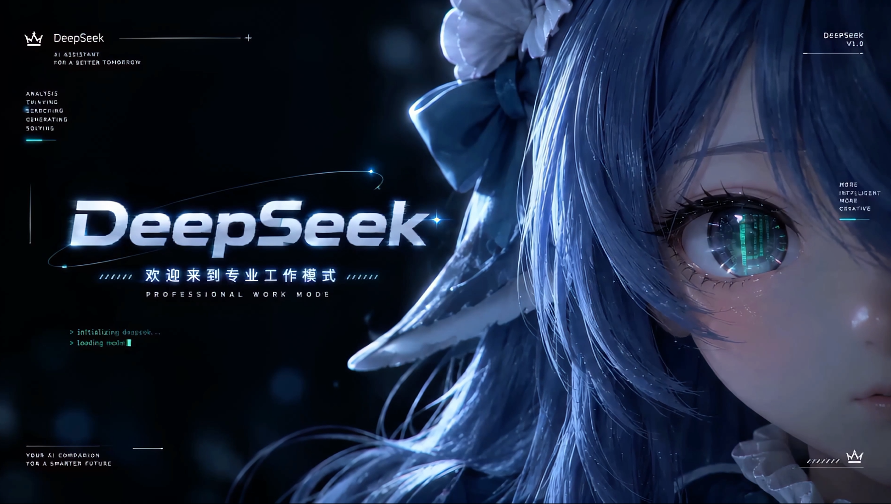

# dsh-theme-orbital · 深潜主题

给 **DSH**（DeepSeek Harness）用的 **DeepSeek Blue（深潜）主题插件**：把 Web GUI 换成
单一品牌蓝、按明度分层的深空界面 —— `BASE #050A14` / `PANEL #070F1C` / `SURFACE #0B1626` /
`GLASS #1B1E25`，品牌色 `#4D6BFE`、光束 `#8AA2FF`、正文 `#E6EDFB`、弱文字 `#55688A`，
所有细线统一为品牌色 14%。启动时播放 **4K 进场影片**，并在**欢迎页与进行中的会话**
都铺一层循环人物壁纸。

**单一方案（固定深色）**：不跟随 DSH 的明暗偏好——即使外观设置为浅色，也渲染设计稿的深色投影。
想回原生浅色界面，用侧栏「深潜主题」开关切回经典界面。

不改 DSH 本体，卸载即还原。






## 它做了什么

| 层 | 做法 | 效果 |
|---|---|---|
| 设计令牌 | 覆盖全部 `--dsw-alias-*` 明/暗两套 + `--dsw-specific-*` 表面色 | 颜色、边框、状态色、代码块、菜单、滚动条一起换成 DeepSeek Blue |
| 几何 | 圆角、过渡时长、阴影层级 | 大圆角玻璃面、低层差、冷色描边阴影 |
| 氛围 | 深空径向蓝光，扫描线默认关闭 | 有「下潜」的空间感，不再铺满横线干扰阅读 |
| 结构 | 框架列、composer、会话区、启动屏、滚动条 | 深灰输入区、左栏品牌色选中条、细线分隔 |
| 动效 | 4K 进场影片（无影片时退回内置 HUD 自检动画）+ 片尾前开始 900ms 交叉淡出 + 主界面揭示 | 冷启动不再是白屏闪一下，也不是「播完卡在最后一帧再硬切」 |
| 窗口顶栏 | 进场期间改掉 DSH preload 探测的标题栏颜色变量（Windows 桌面端） | 右上角最小化/最大化/关闭不再在影片上压一块白底，默认整组隐进画面 |
| 壁纸 | 循环人物影片，模糊压暗后沉到中栏内容之下 | **新会话与已有轮次的会话都显示**，暗色沉、浅色淡，不挡正文 |
| 交互 | 侧栏底部「≈ 深潜主题」开关 + 「▷ 重播」 | 一键在原生界面与本主题间切换，不用重装 |

## 安装

```bash
# 1) 完全退出 DSH 桌面端（desktop profile 的包管理要求宿主不在运行）
# 2) 安装（link 到本仓库）
dsh plugin --profile desktop add "link:D:/project/qujinting/dsh-plugin/theme"
# 3) 重新打开 DSH
```

也可以直接改 `$DSH_HOME/profiles/desktop/package.json`：把 `dsh-theme-orbital` 加进
`dependencies`（`link:` 到本目录）和 `dsh.profile.bundles`，再在该 profile 目录跑一次
`pnpm install`。

卸载：

```bash
dsh plugin --profile desktop remove dsh-theme-orbital
```

> **会改什么、不会改什么**：插件只经由 profile 的 Loader 行与 Web 索引注入生效，
> 不会写 DSH 安装目录、不改 Electron 外壳、不动会话数据。卸载后重开即完全还原。

## 配置

`cordis.patch.yml` 的默认值（可在自己的 profile patch 里按 `id: theme-orbital` 覆盖）：

```yaml
- id: theme-orbital
  name: 'dsh-theme-orbital'
  config:
    enabled: true          # 总开关；false 时宿主一行都不注入
    animation: hud         # hud | fade | none
    introVideo: 'videos/进场60帧4K.mp4'   # 4K 进场影片；'' 关闭，退回 CSS HUD 动画
    backgroundVideo: 'videos/循环播放背景.mp4'  # 循环壁纸；'' 关闭
    backgroundScope: always # always：进行中的会话也保留；empty：只在空白会话显示
    backgroundOpacity: 0.85 # 空白会话/欢迎页的清晰档
    backgroundBlur: 6       # px，0–80
    backgroundOpacityConversation: 0.55   # 进行中的会话：底光强度（两种状态都显示）
    backgroundBlurConversation: 8
    playOn: cold           # always | cold（同一窗口只播一次）
    durationMs: 1500       # 遮罩最短停留，800–4000
    holdMs: 350            # 影片真播完/加载完后，定格多久再开始淡出，0–3000
    introTailMs: 1500      # 片尾静止段：提前这么多毫秒开始交叉淡出，0 = 等播完，0–5000
    titleBar: hide         # 进场期间 Windows 原生标题栏：hide | blend | off
    scanlines: false       # 细扫描线纹理（默认关；开了会在会话上铺一层 1px 横线）
    grid: true             # 中栏深空蓝光氛围层
    glow: medium           # off | low | medium | high
```

影片路径相对插件根目录；`videos/` 里已经带了两段进场（120 帧 / 60 帧 4K）与两段循环背景，
换成自己的 mp4/webm 也可以（只接受视频扩展名，且必须落在插件目录内）。

`introTailMs` 解决「影片播完以后干等」的观感问题：自带的两支进场片最后约 1.5s 几乎是静止的
（实测 5.5s 之后画面基本不动，片长 7s），如果等 `ended` 再淡出，就会先卡在最后一帧上。
默认提前 1500ms 开始交叉淡出，影片边播边淡、主界面同时在后面进场，揭开完成时片子刚好收尾。
换成片尾仍有余韵的影片时把它调小，或设 `0` 回到「等影片真正播完，再按 `holdMs` 定格后淡出」。

`titleBar` 只对 **Windows 桌面端** 生效：`hide`（默认）让右上角那块底板变透明、三个字形取影片底色，
看起来就是没有按钮；`blend` 只把底板变透明、字形换成对比色，按钮仍清晰可见可点；`off` 保持 DSH 原样。
遮罩揭开时字形先还原、底板等遮罩真正移除后再还原，任何异常路径也会清掉覆盖，不会留下一个透明标题栏。
鼠标移到那个角落时 Windows 仍会画出悬停底色，所以隐藏期间按钮依然能点到。

壁纸在**两种会话状态都显示**：会话壳原本不透明的 `--dsw-alias-bg-base` 被放行，
影片以 `z-index: -1` 沉到正文与卡片下面，不再糊在文字上。深色下的会话档是 0.55 透明度 +
8px 模糊 + 0.92 亮度——能看清人物，又不跟正文抢对比度。不想常驻就把 `backgroundScope` 设为 `empty`。

4K 影片解码不便宜：进场只在 `playOn: cold` 下每个窗口播一次；壁纸在会话里虽然仍可见，
但走的是更小的一档（更淡、更糊、压暗），在意功耗就设 `backgroundScope: empty`。

## 它是怎么做到的

DSH 的 Web 客户端本身没有「主题插件」这种一等公民，但留下了四个可用的缝：

1. **索引注入** —— 宿主插件可以在 `webserver/index-inject` 里往每次 index 响应塞
   `style` / `html` / `script` 行。桌面端用 `webServer.collectIndexInjections()` 取同一张表，
   在应用挂载前执行。所以主题样式与启动遮罩都是**首帧之前**就位的。
2. **令牌层** —— ui-layout 把 `--dsw-alias-*` 以**内联样式**写到 `<body>`；插件的样式表
   用 `!important` 声明同名词即可压过它，而且不需要知道用户选的是明色还是暗色。
   但只压令牌不够：应用里还有一批组件（文件改动卡片、diff 底色、菜单）是按
   `body[data-ds-dark-theme]` 选**静态中性色**的。所以主题在应用挂载前就把这个属性挂到
   `<body>` 上，并在被外壳清掉时重新补上，让这些分支也走深色。
3. **启动屏交接** —— 外壳先渲染一块 `[data-dsh-boot]`（HARNESS / Loading plugins…），
   再用 React `hydrateRoot` 换成应用。遮罩层盖住全过程，等 `[data-dsh-boot]` 消失、
   `[data-shell-overlay]` 出现后揭开。影片路径不按 `ended` 硬切：控制器在
   「片长 − `introTailMs`」处就开始 900ms 交叉淡出，主界面的入场动画同时在遮罩后面跑，
   这样片尾的静止段不会变成一次干等。
4. **Windows 标题栏** —— 桌面端 preload 用一个隐藏探针量 `--dsw-specific-sidebar-fill`
   （覆盖层底板色）与 `--dsw-alias-label-primary`（字形色），再经 `windowsAppearance` IPC
   调 `mainWindow.setTitleBarOverlay`。进场期间把这两个变量写进 `<body>` 的内联样式
   （`!important` 压过宿主令牌表），右上角白底板就透出影片；揭开时按字形、底板两步还原。
   探针只观察 body 属性与 head，所以只能写 body 内联样式。这条链路只存在于 Windows 桌面端，
   浏览器与 macOS 上是空操作。

浏览器半区（`lib/client.js`）只做三件事：按 revision **保鲜样式表**（桌面端注入只在启动
时收集一次，刷新页面靠它拿到磁盘上的新 CSS）、维护开关、挂侧栏控件。

### 目录

```
theme/
  palette.json   唯一色值真源：alias / specific / metrics
  theme.css      结构、质感、启动屏、遮罩动画
  boot.html      遮罩标记
  boot.js        揭开控制器（内联注入，暴露 __dshThemePlayVeil）
lib/
  index.js       宿主半区：注入行、/api/dsh-theme/* 路由、诊断
  client.js      浏览器半区：样式保鲜、开关、侧栏控件、window.__dshTheme
test/            离线确定性测试（无浏览器、无 DSH）
```

## 开发

```bash
npm test     # 八个离线测试：manifest / palette / css / inject / routes / client / titlebar / reveal
npm run check
```

| 改动 | 生效方式 |
|---|---|
| `lib/index.js`、`cordis.patch.yml` | **重启 DSH**（Node 模块缓存） |
| `theme/*.css`、`*.html`、`*.js`、`palette.json` | **刷新页面**（客户端按 revision 取新内容） |
| `videos/*`（换影片） | 刷新页面（路由每次请求都从磁盘读） |
| `lib/client.js` | 刷新页面（bundle 按 mtime/size 换代） |

改了遮罩标记（`boot.html`）或配置时，桌面端注入表只在启动时收集一次，**需要重启桌面端**。

### 调试

页面里（DevTools Console）：

```js
__dshTheme.status()    // { enabled, revision, hasInjectedStylesheet, playVeil, lastError }
__dshTheme.replay()    // 重播入场动画
__dshTheme.disable()   // 临时切回原生界面（持久化）
__dshTheme.enable()
```

宿主路由（仅回环可访问）：

| 路径 | 用途 |
|---|---|
| `GET /api/dsh-theme/status` | 配置、revision、影片路径、各文件 revision |
| `GET /api/dsh-theme/injected.css` | 与注入内容一致的完整样式表（支持 `?rev=` / ETag → 304） |
| `GET /api/dsh-theme/theme.css` | 仅作者样式表 |
| `GET /api/dsh-theme/palette.json` | 色板 |
| `GET /api/dsh-theme/boot.html`、`boot.js` | 遮罩标记与控制器（供「重播」） |
| `GET /api/dsh-theme/video/intro`、`video/bg` | 进场影片与循环壁纸（支持 `Range`，浏览器起播必需） |

失败不会白屏：控制器与客户端半区都整段 `try/catch`，异常写进
`localStorage['dsh-theme-orbital.last-error']`；没有影片时遮罩另有 CSS 兜底（4s 自动淡出），
影片路径则由 JS 的 6s 起播超时 + 定格/淡出收尾兜底，且遮罩全程 `pointer-events: none`。

## 设计语言（DeepSeek Blue · 深潜）

单一色相，按明度分层；所有细线统一为品牌色 14%。

| 令牌 | 值 | 用途 |
|---|---|---|
| BASE | `#050A14` | 应用底色 |
| PANEL | `#070F1C` | 侧栏 / 原生标题栏 |
| SURFACE | `#0B1626` | 一级面板、卡片 |
| GLASS | `#1B1E25` | 输入区、控件面（深灰） |
| BRAND | `#4D6BFE` | 品牌色：选中条、焦点、按钮 |
| BEAM | `#8AA2FF` | 次级高光、链接、字形 |
| INK | `#E6EDFB` | 正文 |
| MUTED | `#55688A` | 弱文字、元信息 |

字体：界面正文 13 / 行高 22；统计与状态行沿用等宽。palette 里仍保留 light 投影
（同一色相推导的 `#F4F7FE` / `#3D5AF1`），但当前版本只渲染 dark；切回经典界面即原生浅色。

## 已知限制

- **布局是 CSS 重塑，不是结构替换。** DSH 的 `root` 槽是单占用、由 ui-layout 持有，
  插件无法替换 React 组件树；所以三栏骨架、拖拽手柄、折叠逻辑都保持原样，
  主题改的是表面、留白、分隔与装饰。刻意不改 `grid-template-columns`：手柄按列宽
  绝对值定位，改几何会让它错位。
- **壁纸要让会话壳「放行」。** 会话壳 `.an3WzG_root` 自己涂了一层不透明的
  `--dsw-alias-bg-base`，所以主题用 `div:has([data-conversation-region])` 把它改成透明，
  再把影片压到 `z-index: -1`，壁纸才能在进行中的会话里沉到正文下面。类名是构建哈希，
  主题只依赖 `data-conversation-*` 属性与结构；升级 DSH 后若这层结构变了，先看这一条。
- **少量选择器跟版本走。** 组件钩子优先用 `data-composer-*` / `data-conversation-*` /
  `data-chat-*` 这类稳定属性；但 AppFrame 的三列没有稳定属性，只能按结构
  （`#root div:has(> [data-shell-overlay]) > div:nth-of-type(n)`）定位。这部分集中在
  `theme.css` §2，升级 DSH 后若列结构变化只改这一处。当前适配 **0.2.1-rc.5**。
- **同一个组合里只装一个主题插件。** 令牌用 `!important` 压过内联值，两个主题会互相盖。
- **单方案深色。** 设计稿只有 dark 投影：宿主令牌层把 `pair.dark` 同时写进
  `html body` 与 `html body[data-ds-dark-theme]`，浏览器半区再把 `pair.dark` 以
  body 内联 `!important` 覆盖一遍，并把 `data-ds-dark-theme` 挂到 body（连
  `color-scheme` 一起锁成 dark），所以 DSH 的浅色偏好不会把界面变亮。想要浅色原生界面，
  用侧栏开关切回经典界面。
- **桌面端欢迎窗口**（`renderer/welcome.html`）与主窗口尺寸都属于 Electron 外壳，插件进不去；
  动画从欢迎窗口之后、应用索引加载时开始。
- **Windows 标题栏只能改颜色，不能移除。** 那三个按钮由 Chromium/Windows 画在网页之上，
  插件能做的是底板色与字形色（经 preload 探针 + `windowsAppearance` IPC）。`hide` 让字形等于
  影片底色，视觉上等同隐藏；悬停时 Windows 仍会画出悬停底色，按钮始终可点。非 Windows 平台该项无效。
- `playOn: cold` 用 `sessionStorage` 判定，等价于「每个窗口会话一次」；桌面端同一窗口
  刷新不会再播。
- `backgroundScope: always` 下 4K 壁纸会持续解码（开销比欢迎页常驻时略高）。
  在意功耗就设 `empty`，或在会话里把 `backgroundOpacityConversation` 调低到不接受为止。

## 许可

插件代码 MIT（见 [LICENSE](LICENSE)）。不含第三方字体、图片或模型；遮罩里的图形是
内联 SVG，颜色取主题自己的品牌蓝 / 光束蓝。
